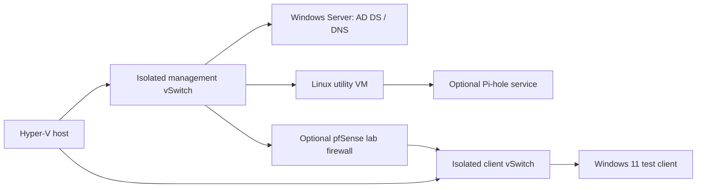

# Planned lab architecture

Status: design only. All labels are synthetic. No production network is represented.

Start with an internal/private virtual switch; do not connect a lab DHCP server to a
physical workplace LAN. Choose one DHCP authority per lab segment. Document DNS
forwarding and AD DNS dependencies before adding Pi-hole. The sketch is not a
complete routing configuration: add the chosen DHCP location, routes, firewall rules,
and DNS paths after validating them. VLANs are an optional later exercise; separate
virtual switches do not prove that physical VLAN tagging is configured.

Use lab.invalid for synthetic identity examples. Keep real recovery credentials private.
Record actual CPU/RAM/storage constraints before allocating VMs. Proxmox can replace
Hyper-V if chosen later; document one reproducible implementation first.
