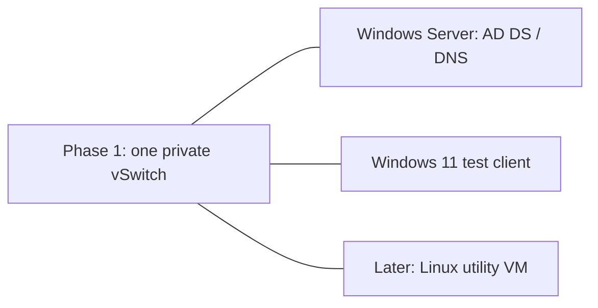

# Planned lab architecture

Status: design only. All labels are synthetic. No production network is represented.

Phase 1 places the domain controller and test client on the same private switch and
subnet. Use static lab addresses initially; add one documented DHCP authority later.
A Hyper-V private switch does not connect the VMs to the host or external network.
An internal switch also connects the host; choose deliberately and document the result.
Do not bridge a lab DHCP server onto a physical workplace LAN.

Phase 2 can add a second subnet only after the baseline works. Separate switches do
not route between themselves: a configured router/firewall VM is then required, with
one interface on each intended segment and explicit DNS/AD traffic rules. Record the
routes and verify allowed and denied flows. This routed phase is not shown as complete.

Pi-hole is an optional later DNS exercise; it does not replace AD DNS requirements.
Document resolver/forwarding paths and keep only one DHCP authority per segment.
VLAN tagging is a separate optional exercise; separate virtual switches do not prove
that physical VLANs are configured.

Use lab.invalid for synthetic identity examples. Keep real recovery credentials private.
Record actual CPU/RAM/storage constraints before allocating VMs. Proxmox can replace
Hyper-V if chosen later; document one reproducible implementation first.
